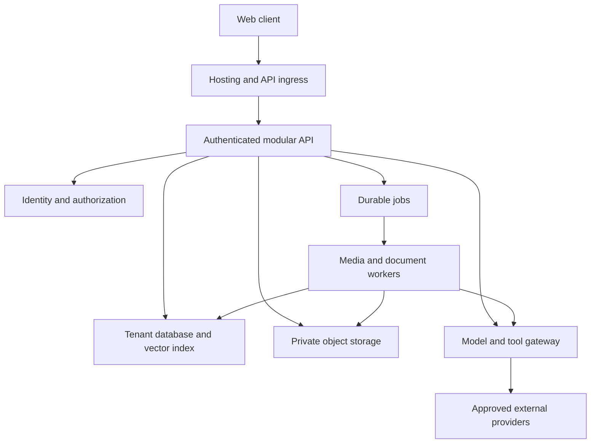

# RaOne AI Studio — Evidence-Based Repository Audit & Enterprise Build Blueprint

**විගණන දිනය:** 2026-11-14, Asia/Colombo  
**Input:** `RaOne-AI-main.zip` සහ user supplied sidebar screenshot  
**Archive commit comment:** `a8772c81e69cba7c756b0f702d7a4be9f9ae2ccb` — ZIP metadata; independently verified Git history නොවේ.  
**ZIP SHA-256:** `2eac5836bc372a6a4132923b74fa91b26a5fbba9aa9c7f48d822fcf948b3d9c5`

## 1. තීරණය — දැනට public enterprise launch සඳහා NO-GO

සුද්දා, මේ repository එකේ පාවිච්චි කළ හැකි React UI, chat streaming adapters, Firebase login integration, studio screens, CRUD endpoints සහ deployment configuration තියෙනවා. නමුත් මේ snapshot එක **multi-user enterprise production platform එකක් ලෙස සුරක්ෂිතව release කිරීමට සූදානම් නැහැ**. ප්‍රධාන හේතු authentication bypass, shared storage, unauthenticated administrative operations, unsafe generated-code preview, simulated outputs සහ reproducible build failure.

“Silicon Valley Grade” කියන්නේ නිල certification එකක් නොවේ. මෙහි එය අර්ථ දක්වන්නේ **verified isolation + accurate product behavior + durable data + operational reliability + measurable quality + auditable governance** ලෙසයි. “85% ready”, “100% secure”, “zero hallucinations” කියන blanket claims සඳහා මෙම code එකෙන් සාක්ෂි නොලැබේ.

### Scope සහ සීමා

- ZIP හි **files 93**: UTF-8 readable files **59**, binary/image files **34**. Text lines **29,661**; `.ts/.tsx/.css` lines **23,612**. Lockfiles සහ generated templatesත් line totals වලට ඇතුළත් වේ.
- සියලු text files inventory සහ cross-repository pattern/route/dependency scans කළා. Security-critical code, persistence, AI generation, export, frontend wiring සහ deployment paths line references සමඟ සෘජුව කියවා පරීක්ෂා කළා.
- මෙය **repository-wide static review + selected local dynamic verification**. සෑම line එකකටම independent manual proof එකක්, සෑම UI interaction එකකටම browser test එකක්, හෝ complete formal verification එකක් කළා යැයි නොකියයි. “line-by-line level” අවශ්‍යතාවට findings සඳහා exact file/line anchors සහ full route/file inventory ලබා දෙයි; exhaustive manual coverage තවම certification-grade ලෙස complete නොවේ.
- Live Firebase/Cloud Run deployment, IAM, production secrets, provider accounts, billing records, DNS, backups, actual sign-in settings සහ deployed Firestore rules පරීක්ෂා කළේ නැහැ. Source configuration එක actual deployment evidence ලෙස නොසලකයි.
- Tests සඳහා වෙනම local runtime copy එකක්, synthetic data සහ provider credentials නොමැති environment එකක් භාවිතා කළා. Original ZIP හෝ deployed service වෙනස් කළේ නැහැ.
- Source code security/compliance gap assessment එකකි; legal opinion, SOC 2 examination, ISO certification, full penetration test, load test හෝ accessibility conformance certification නොවේ.

## 2. Build සහ runtime verification

| Check | Result | Meaning |
|---|---|---|
| Original `npm ci --ignore-scripts --no-audit --no-fund` | **FAIL: EUSAGE** | Package/lock completeness mismatch; platform packages missing in lockfile |
| Diagnostic `npm install --ignore-scripts --package-lock=false --no-audit --no-fund` | PASS | Dependencies resolved without altering submitted lockfile; this is not proof original locked build is reproducible |
| `npm run lint` | PASS | Runs `tsc --noEmit`; not ESLint, security test or runtime test |
| `npm run build` | PASS after diagnostic install | Vite frontend build completed; warnings remain |
| Runtime | Started locally | Node **24.22.1**, npm **11.9.0**; production Docker Node 22 image not tested |
| Frontend output | JS 1,058.12 kB, gzip 293.07 kB | One large JS chunk; CSS 118.84 kB; no browser performance score inferred |
| Security/API checks | 16 observations confirmed | See appendix; most confirmations are defects, not passing security controls |

Diagnostic install resolved Vite 8.3.8. Submitted manifest has ranges, so these checks do not prove the exact lock-resolved production artifact. Original Dockerfile uses `npm ci`; CI uses `npm ci || npm install`, hiding reproducibility failure. Run the corrected lockfile on the exact pinned production runtime before release.

### Locally reproduced defects

1. `/api/projects` without token → 401 with strict flag set; a 25-character non-JWT Bearer value → **200**.
2. No-token conversation write and read → **200**.
3. No-token plan change to `ultimate` → **200**.
4. No-token global API-key update → **200**, using only a synthetic dummy value.
5. Arbitrary Origin reflected with `Access-Control-Allow-Credentials: true` when allowlist unset.
6. Vision no-provider generation → success with bundled image; motion → sample MP4; audio → sample SoundHelix track.
7. Lyrics-only audio request → **500**, `prompt.split` on undefined.
8. Document generation without provider → success with a hardcoded citation.
9. DOCX/PPTX/XLSX responses → **200**, but bytes are HTML/legacy XML, not OOXML ZIP containers.
10. No-token account-reset endpoint → **200**.

## 3. Findings register — priority, evidence, remediation, exit test

**P0:** public launch blocker. **P1:** production baseline requirement. **P2:** capability/product maturity. Severity is engineering assessment, not a calculated CVSS score. File paths below are relative to extracted repository root; line numbers refer to supplied snapshot.

| ID / priority | Finding and code evidence | Required correction / acceptance evidence |
|---|---|---|
| A01 / P0 Critical | `server.ts:120–135`: guard checks only Bearer prefix/length; no signature, expiry, issuer or audience verification | Firebase Admin `verifyIdToken`; bind verified UID to request. Invalid/expired/wrong-project tokens must all fail |
| A02 / P0 Critical | Guard only attached to settings GET/POST and projects GET/POST/DELETE; conversations at `1669–1754`, media and administrative routes unguarded | Default-deny protected API router; explicit public allowlist; test every route unauthenticated and cross-tenant |
| A03 / P0 Critical | Shared JSON reads/writes, e.g. `167–189`, `1669–1708`; no owner predicate | Durable tenant-scoped repository; A cannot list/read/update/delete B records by guessed IDs |
| A04 / P0 Critical | `2569–2624` mutates global provider keys; `1358–1376` build-app body also changes global Gemini credential | Remove user-to-global key mutation. Admin control plane or encrypted tenant BYOK. User A change cannot affect B |
| A05 / P0 Critical | `2627–2660`: caller-controlled Comet URL receives request with stored key if no key supplied | SSRF and credential-exfiltration risk from source analysis. Approved HTTPS origins, egress controls, block internal IPs/redirect escape/DNS rebinding; verify with local dummy key capture tests |
| A06 / P0 Critical | `GoogleAIStudioWorkbench.tsx:317–318`: untrusted `srcDoc` uses scripts + same-origin sandbox; keys stored in localStorage at `120–155` | Separate credential-free preview origin; omit same-origin where possible; strict message validation; generated app cannot read parent DOM/storage or invoke authenticated APIs |
| A07 / P0 High | `server.ts:431–447`: plaintext key JSON vs policy claim encrypted at `1856` | Secret Manager for service credentials, KMS-backed tenant secrets, rotation and audit; remove misleading claims |
| A08 / P0 High | JSON filesystem is primary state; async read-modify-write can lose updates; write errors swallowed at `182–188` | DB transactions/version checks; fail API on persistence error; restart/multi-instance/concurrent-write tests |
| A09 / P0 High | `839–857`: caller selects paid plan; no payment verification | Entitlements driven by verified payment events; no direct paid entitlement setter for ordinary users |
| A10 / P0 High | `938–989`: clear/export/delete operate on shared state; delete-account resets settings/chats/plan only | Reauthentication, ownership, complete deletion workflow; revoke sessions, delete assets/indexes/connectors; tracked retention exceptions |
| A11 / P0 High | `SettingsModal.tsx:891–895`: MFA button merely flips state and success notice | Real enrollment/challenge/recovery/revocation; UI must not claim enabled until identity provider confirms |
| A12 / P0 High | `server.ts:3756–3865`: image failure silently returns bundled image; requested model/knobs mostly metadata | Explicit demo status or real provider result; record actual provider/model; no charge or generated label for samples |
| A13 / P0 High | `3904–4110`: image upscale metadata only, ControlNet selects asset, inpaint reuses image, LoRA immediately “Ready” | Disable unsupported functions or real worker processing with verifiable output and training artifact |
| A14 / P0 High | `4221–4311`, `4349–4494`: sample videos, duration/FPS/dimensions/foley metadata mutations | Real video adapter/worker and ffprobe validation; frame/bitstream must actually change |
| A15 / P0 High | `4574–4601`, `4713–4910`: voice clone random metrics/sample track; music/stems sample URLs | Real contracted audio services or clearly marked demos; consent-led voice lifecycle; independent stems verified |
| A16 / P0 High | `4966–5235`: fallback document metrics/citations and graph/OCR labels unsupported by processing | Remove fabricated citations/metrics; use source-bound evidence IDs; fail explicitly on provider error |
| A17 / P1 High | `5273–5460`: native Office MIME/extensions on HTML/XML bytes | Actual OOXML export libraries and PDF engine; parse exported files with independent reader; render and inspect |
| A18 / P1 High | `138–160`: default CORS reflects arbitrary Origin; `41–69`: CSP eval/inline/wildcards and iframe navigation relaxes frame ancestors | Explicit origins, secure default, separate app/preview CSP; enforce on actual Hosting surface, not only Express |
| A19 / P1 High | `73–117`: fixed-window counter (comment says sliding), trusts first forwarded IP, process-local map | Trusted ingress normalization; UID/tenant/IP budgets; shared quota backend; concurrency caps; spoof and boundary-burst tests |
| A20 / P1 High | `163–164`: global 50 MB body limit; route schemas weak; no cost-level quotas | Endpoint-specific size limits, schemas, maximum context/media limits; reject before provider call; no unrestricted expensive loops |
| A21 / P1 High | `App.tsx:29–42,209–224`, Library keys: storage not UID scoped; auth callback only sets user | Per-user cache, purge on logout/switch, server-authoritative reconciliation; account-switch test cannot show prior data |
| A22 / P1 Medium | `ChatInputDock.tsx:200–208`: only attachment filenames sent, not bytes | Signed upload + attachment IDs + parsing; answer test must depend on content rather than filename |
| A23 / P1 Medium | `ChatMessageItem.tsx:95–98`: active chat renders plain string; no Markdown/code/math parser | Safe Markdown, syntax highlighting and KaTeX; block unsafe URLs/raw HTML; Sinhala/code/table rendering tests |
| A24 / P1 High | `server.ts:3110–3370`, `server_groq_service.ts:278,340`: no explicit request abort/deadline/backpressure lifecycle | Deadlines, disconnect cancellation, heartbeat, bounded output and provider-specific retry; no blended answer after partial-stream failover |
| A25 / P1 High | `server_app_synthesizer.ts:50–96`, `server.ts:1420–1466`: “verified/0 errors/deployed” steps constructed without executing tests | Real run records, test logs and artifact hashes; generated ≠ compiled ≠ tested ≠ deployed |
| A26 / P1 High | Docker `npm ci`, lock mismatch; workflow fallback install; no shipped test suite found | Fix/pin lock/runtime, reproducible CI, PR checks, immutable artifacts, audited promotion and rollback |
| A27 / P1 Medium | `DocumentAIStudio.tsx:263–271`: `readAsText` for uploads | Binary-aware parser/OCR pipeline; invalid/encrypted/oversized files must have explicit states |
| A28 / P1 Medium | `server.ts:4759–4766` title derivation uses `prompt.split` even when only lyrics accepted | Normalize optional inputs; lyrics-only/instrumental/empty/title cases validated; observed 500 fixed |
| A29 / P1 Medium | `firebase.json`: Hosting SPA rewrite only; policies implemented on Express; no Hosting security header configuration | Test public privacy/terms paths, configure static/legal route or rewrite, attach headers to correct delivery surface |
| A30 / P1 Medium | Generated export URLs at `5143–5146` create fresh timestamps rather than saved ID | Construct URLs from actual document ID; nonexistent IDs return 404 instead of default document |
| A31 / P1 High | Policy at `1848–1892` overstates encryption/isolation/provider handling; actual providers include OpenAI/Anthropic/DeepSeek/Comet | Accurate data-flow/subprocessor disclosures and retention behavior; policy-to-control evidence matrix |
| A32 / P2 Medium | `App.tsx:7–24` eagerly imports studios; build chunk ~1.06 MB; large PNG branding assets | Lazy-load studios, responsive optimized assets, virtualization, measured real-device budgets |

**Important:** A05/A06 are source-evidenced attack paths; remote exploitation, browser sandbox proof and production reachability were not tested. A01/A02/A04/A09/A10 and selected output defects were reproduced locally. Missing audit evidence is not proof an external operational control does not exist; it means this ZIP cannot establish it.

## 4. කලින් report එක නිවැරදි කළ යුතු තැන්

| Prior claim | Snapshot evidence-based correction |
|---|---|
| Frontend/API “85%+ enterprise grade” | No scoring rubric/test evidence; percentage withdrawn |
| Strict auth flag solves authentication | Guard itself is bypassable and most routes do not use it |
| Firebase security rules protect backend data | Rules file exists; CRUD is JSON. Admin SDK later also requires server-side authorization because Admin bypasses client rules [S2] |
| Google/Email sign-in enabled | Client helpers exist; provider enablement in actual Firebase project was not inspected |
| Rules deployed / Cloud Run deployed | Repo contains configuration and hardcoded URL; actual deployed revision/rules unknown |
| Markdown/code rendering already implemented | Active `ChatMessageItem` displays raw text; include real rendering in build scope |
| Full file attachment handling | Main chat sends filenames only |
| Multi-file React app generation | Live builder requests single-file HTML; files are extracted/metadata. Template engine is deterministic routing, not a verified multi-agent build system |
| Publish/share deployment | Code Studio Publish downloads HTML; Share copies HTML or page URL |
| Native Office export missing entirely | Export route exists (`app.all`); its output formats are invalid for native Office extensions |
| Project instructions need adding from zero | Backend saves `instructions` (`1790–1824`) and App injects them (`469,556`); management UI, ACL and knowledge retrieval still need completion |
| Settings stored in plan file | Separate `user_settings_data.json`; plan is `user_plan_data.json` |
| Eight JSON stores total | Additional prompts, settings, key store, voice clone store are defined even if absent from archive |
| Sliding-window limiter | Implementation is fixed-window counter |
| Thought-process viewer | Displays model/provider/token/latency metadata assembled by `buildThoughtProcess` (`App.tsx:436`); not authenticated internal reasoning |
| Model names in selector imply engine availability | Require live capability discovery/probe. Some hardcoded IDs are unverified in this review; do not infer availability or invent replacement IDs |
| “RaOne Suno Audio” implies Suno integration | Main audio generate endpoint returns SoundHelix samples; label is not evidence of provider contract or integration |

## 5. Enterprise architecture — one coherent target

### Recommended delivery approach

දැනටමත් React + Express + Firebase context එකක් තිබෙන නිසා **modular monolith API + separately isolated workers** වලින් පටන් ගන්න. Microservices ගොඩක්, Kubernetes, Kafka, dedicated H100 clusters, Neo4j, multiple vector DBs සහ Redis එකවර ගොඩනගන්න අවශ්‍ය නැහැ. Workload evidence එකෙන් වෙන් කළ යුතු service තෝරන්න.

**Primary blueprint:** Firebase Authentication + Cloud Run modular API + PostgreSQL (Cloud SQL) as authoritative transactional DB + pgvector for initial retrieval + private GCS + Cloud Tasks / job workers + Secret Manager + structured telemetry. මේක proposed engineering choice එකක්; current implementation එකක් නොවේ.

**Lower-operations alternative:** Firestore as sole primary OLTP store with transactions, indexed owner-scoped queries and carefully designed billing ledger. Firestore සහ PostgreSQL දෙකම එකම record එකට authoritative නොකරන්න. Existing rules තිබීම පමණින් Firestore migration complete නොවේ. SQL තෝරාගන්නේ relational memberships, billing reconciliation, content lineage සහ joins වෙනුවෙන්; budget/operations constraints අනුව Firestore route එකත් valid.

Generated code execution වෙනම trust boundary එකක්. Preview domain එකට app cookies/credentials දෙන්න එපා. Workers සඳහා වෙනම least-privilege service accounts. Model output, retrieved document සහ plugin response තුනම untrusted data ලෙස සලකන්න.

### Layers → sublayers → required contracts

| Layer | Sublayers | Required implementation |
|---|---|---|
| L1 Experience | Shell, studios, chat, accessibility, localization | Design tokens, accessible primitives, responsive layouts, route state, capability-driven controls, loading/error/cancel/empty/offline states |
| L2 Edge/API | Routing, schemas, quotas, streaming | Versioned OpenAPI, typed client, auth middleware, explicit public routes, CORS/CSP, error envelope, request IDs, idempotency |
| L3 Identity | Accounts, tenants, memberships, sessions, admin | Cryptographic tokens, server policy engine, project/resource ACLs, real MFA, step-up auth, enterprise SSO/SCIM only when required |
| L4 Orchestration | Context, tools, workflows, jobs, checkpoints | Trusted/untrusted context separation, token budget, tool grants, durable state, retry/cancel/deadline, human approval for external writes |
| L5 Inference | Model registry, adapters, media, safety, evaluation | Capability schemas, provider/model provenance, quota/cost controls, explicit fallback behavior, pinned tested model configurations |
| L6 Data | OLTP, blobs, vectors, audit, retention | Tenant keys/constraints, private objects, signed access, source citations, backups, migrations, export/delete, search ACLs |
| L7 Integration | OAuth, MCP, webhooks, outbound network | Token vault, exact redirect URI, scopes, state/PKCE where applicable, egress allowlist, revocation, installation isolation |
| L8 Commercial | Plans, entitlements, credits, invoices | Payment-event state machine, immutable usage ledger, reservations/settlement/refunds, spend limits, reconciliation |
| L9 Operations | CI/CD, IaC, telemetry, DR, incidents | Reproducible artifacts, deploy gates, canary/rollback, SLOs, alerts, restore drills, on-call runbooks |
| L10 Governance | Privacy, security, vendor, AI quality, support | Data map, policies matching behavior, consent records, rights requests, model evals, evidence register, incident response |

## 6. Screenshot sections — complete build requirements

මෙහි “Done gate” කියන්නේ ඒ section එක enterprise-ready යැයි පිළිගැනීමට අවශ්‍ය measurable evidence එකයි. සියලු sections සඳහා A01–A10 shared foundation blockers අදාළයි.

### Section 1 — Top Brand Header / Search / Collapse

**Current:** `Sidebar.tsx`, `App.tsx:88–154` — branding, sidebar search trigger, collapse සහ keyboard shortcuts. Ctrl+K starts new chat; Ctrl+/ searches chats.

**L1 → Navigation:** route-driven navigation, deep links, active studio state, reload/back/forward support, consistent drawer focus, mobile safe areas, keyboard focus restore, reduced-motion support. Command palette එකක් add කරන විට Ctrl+K collision resolve කරන්න: screenshot shortcut preserve කර palette සඳහා වෙනත් shortcut හෝ documented reassignment.

**L2/L6 → Search:** owner-scoped query across chats/projects/assets, debouncing, pagination, result snippets, permission-filtered index; background indexing with deletion propagation. Private titles autocomplete හරහා වෙන tenant කෙනෙකුට නොපෙන්විය යුතුයි.

**L9 → Brand/assets:** optimized WebP/AVIF or vector icons, correct dimensions, cache headers, lazy load; app identity and legal pages consistent. Static header logo download සඳහා MB-size PNGs අවශ්‍ය නැහැ.

**Done gate:** keyboard-only navigation, 320px/mobile and desktop layout review, no shortcut conflict, cross-tenant search isolation, screen-reader names, focus tests. Screenshot visual match සඳහා reference viewport/image diff වෙනම test suite එකක්.

### Section 2 — New Chat / Conversational Workspace

**Current:** SSE adapters, temporary in-memory client conversation branch, metadata panel, provider routing, conditional Google grounding, browser speech facilities. Markdown and attachment content handling incomplete.

**L1 → Conversation:** safe Markdown/code tables, KaTeX, selectable/copyable code, edit/regenerate, parent-linked branches, message delivery states, stop/retry, citation cards, artifact viewer, attachment progress, image/audio previews, error recovery. Show execution metadata and useful reasoning summaries without presenting fabricated internal chain-of-thought.

**L2/L4 → Chat runs:** `conversation_id`, `branch_id`, `parent_message_id`, `run_id`; persisted user message before run, stream event IDs, heartbeat, disconnect handling, deadline, partial-result state, retries with deduplication. If output already streamed, failover starts a separate attempt; do not append a different provider’s answer into the same text invisibly.

**L4 → Context compiler:** authenticated project instructions, bounded recent messages, summary versions, authorized memory, retrieved evidence; mark provenance and trust level. User/project context cannot authorize tool execution or override tenant policy. Token budgets and truncation disclosures.

**L5 → Provider gateway:** actual executed model, provider request ID, usage, latency and fallback reason. Capability matrix for text/image/audio/grounding/tool calls; unknown model ID fails clearly. Provider failure must not become a fake success.

**L6/L10 → Privacy:** temporary mode controls cache, logs, analytics, objects, provider retention settings and expiry, not only prompt wording. User-visible retention statement must reflect external providers. Regular history server-authoritative; local cache partitioned by UID/tenant.

**Done gate:** stream cancel/disconnect/fallback tests; source-grounded answer from uploaded content; no retention artifacts for temporary local paths; declared provider retention documented; account switch isolation; branch replay consistency.

### Section 3 — RaOne Code Studio

**Current:** single-HTML synthesis via configured model, deterministic template fallback, pseudo multi-file breakdown, iframe preview. Publish = download. Agent validation/deployment steps are not real execution evidence.

**L1 → IDE:** editor with syntax/lint, project tree, diff review, terminal output, build logs, dependency view, snapshots/undo, clear “Generated / Building / Tested / Preview / Published” states.

**L4 → Build workflow:** spec → file plan → generation → schema/path validation → dependency resolve → compile → tests → preview. Bounded iteration, checkpoint/restart, cancellation and budget. Multi-agent DAG is optional later; execution correctness is required first.

**L3/L5 → Sandbox:** disposable per-run isolated compute, non-root UID, CPU/memory/pid/disk/time limits, network denied by default, no cloud metadata/host filesystem/Docker socket, no app credentials, scanned dependencies and restricted package scripts. Docker alone is not sufficient tenant isolation for hostile code. Browser WebContainers are a frontend preview option, not a substitute for secure backend execution.

**L6 → Versioning:** project/file/revision/build/artifact/test-result entities, content hashes, immutable output versions, provenance and asset ownership. Verify filenames cannot traverse directories.

**L7/L9 → Git/publish:** scoped GitHub installation, explicit target repo/branch, diff+commit, CI result, preview deployment, domain/TLS, rollback. Deployment credentials accessible only to release service, never generated apps. Do not deploy based only on AI “verified” text.

**Done gate:** generated code cannot read parent storage or internal network; package/path attack tests; sample app compiles and tests; publish creates a real URL with deployment ID; rollback restores prior hash.

### Section 4 — RaOne Vision Studio

**Current:** real SDK image call attempted, static fallback; multiple advanced controls are metadata/sample pipelines.

**L1 → Editor:** capability-aware prompt/negative prompt/ratio/seed/batch UI; mask paint and undo, reference upload, before/after comparison, supported dimensions, visible progress and credit estimate. Unsupported controls disabled with accurate explanation.

**L4/L5 → Image pipeline:** approved image provider adapter; normalized input→provider job→validated binary output. Inpaint must use mask/base image, pose control must consume control map, character/reference conditioning must use the reference. Upscale must create new pixel dimensions. Model-specific limitations surfaced.

**L6 → Assets:** private source/output objects, checksum/MIME/dimensions, thumbnails, metadata, original/version relationship, user/project ownership, attribution/licensing and retention. Do not store base64 in OLTP JSON.

**L10 → Governance:** content rules, consent for likeness-sensitive functions, source/licensing record, generated-media labeling/provenance where supported. LoRA training requires authorized dataset, preprocessing, job progress, weights artifact, evaluation, deployment and deletion, not a ready flag.

**Done gate:** change prompt/seed/mask/reference and verify actual model behavior; malformed image rejected; pixel dimensions checked; provider failure refunded and shown as failed; no sample classified as generated.

### Section 5 — RaOne Cinema Studio

**Current:** sample MP4 selector; extension/interpolation/upscale set metadata without processing media.

**L1 → Motion workspace:** storyboard/shot list, reference frames, supported camera controls, keyframes where supported, trim/extend, source/result comparison, caption/subtitle tracks, cancellation and resumable job visibility.

**L4/L5 → Async jobs:** real supported video provider; start/poll/webhook/cancel contracts, durable provider job ID, out-of-order event handling, retries, deadline and orphan reconciliation. FFmpeg worker handles approved transcoding/audio mux; avoid constructing shell commands from untrusted strings.

**L6 → Delivery:** original master, derived MP4/HLS where useful, posters/captions, codec/duration/FPS/resolution metadata from media probe, signed private playback, byte-range support, expiry-safe refresh.

**L8/L9 → Reliability/cost:** reservation based on duration/resolution/model; storage/egress budget, concurrency ceilings, timeout compensation. Client closing tab cannot lose the job or duplicate billing.

**Done gate:** ffprobe confirms requested duration/FPS/resolution; actual frames/interpolation validated; job survives worker restart; duplicate webhook has one effect; output accessible only to authorized user.

### Section 6 — RaOne Suno Audio

**Current:** lyric enhancement can call text models; main music output, cloning and stems are sample media/metadata. There is a reproduced lyrics-only 500.

**L1 → Audio workspace:** lyric editing and versioning, supported style/vocal controls, waveform, transport/scrub/loop, independent stem gain/mute/solo, export formats, lyrics timing and clear generation states.

**L5 → Real engines:** select a provider with documented, authorized API access and commercial rights. Do not assume Suno/Udio names imply public API availability. TTS, music synthesis, ASR and voice cloning are distinct contracts; route each correctly. Self-host licensed audio models only after hardware/cost tests.

**L4/L6 → Processing:** track job → output integrity probe → normalized master → waveform → optional stem worker. Persist real duration/sample rate/channels, model/provenance, source/output linkage. Stem outputs must derive from the same source; validate synchronization and separation quality.

**L3/L10 → Voice rights:** explicit informed consent, evidence of authorization, retention/deletion, revocation, anti-impersonation controls and misuse review. Random formant values are not a voice clone. Vendor permission and brand use review before claiming “Suno” integration.

**Done gate:** prompt/lyrics change audible output; lyrics-only request passes; stems contain distinct components; consent revocation disables future use; job retries do not charge twice.

### Section 7 — RaOne DocuStudio

**Current:** text-to-JSON document generation, text upload reading, model-produced citations, static graph metadata/audio samples and mislabeled Office exports. No implemented vector retrieval pipeline established.

**L1 → Document workspace:** upload queue, extraction/OCR progress, page/slide/sheet viewer, source selector, inline citation navigation, editable content blocks, true slide and spreadsheet previews, export validation errors. Clearly show when answer lacks evidence.

**L4/L5 → Ingestion:** signed direct upload → quarantine → file signature/size/page limits → malware/zip-bomb checks → sandbox parser. PDF text/OCR with page boxes, DOCX paragraphs/tables, PPTX slide text/notes, XLSX sheets/formulas/data types; encrypted/corrupt formats have explicit failure. External links/macros disabled during parsing.

**L6 → RAG:** source versions and hashes → structure-aware chunks → embedding model/version/dimensions → tenant/project-filtered vector + lexical retrieval → rank fusion/reranking when evaluation justifies → bounded context. Each citation stores source ID, version, page/section, offsets and quoted span. Model-generated URLs/titles alone are not evidence. Re-check ACL at retrieval and response time.

**L5 → Answer quality:** reference-free refusal/uncertainty, conflict handling, quote validation, retrieval precision/recall, groundedness and Sinhala OCR/answer evaluation. Citation correctness must be tested separately from fluent writing.

**L6 → Native exports:** structured intermediate document model → real DOCX/PPTX/XLSX/PDF renderers; templates/fonts, editable text, formulas typed correctly, formula-injection safeguards for imported CSV, charts and metadata. OOXML package structure validated; open in independent reader and render representative pages/slides/sheets. PDF is not an extension rename.

**L5 → Audio overview:** source-grounded script, source citations, contracted TTS voice, real audio generation; transcript must match audio. A background song is not a narrated summary.

**Done gate:** varied real binary fixtures parse; answer cites correct page/slide/cell; cross-tenant retrieval denied; deleted document removed from search; exports open without repair dialog and preserve Sinhala text; bad document ID returns 404.

### Section 8 — Library

**Current:** five history APIs aggregated client-side; local folders/favorites. Grid/list/filter/sort/lightbox controls exist.

**L6 → Unified catalog:** single asset API with stable IDs, owner/tenant/project, modality, version, source run, object reference, thumbnail, integrity fields, lifecycle state, tags, rights and size. Folders and membership persisted on server; user favorites distinct from shared asset state.

**L1/L2 → Experience/API:** cursor pagination, server filtering/sort, virtualized grid, multi-select, resumable download, async ZIP export, folder moves, undo/trash, duplicate handling, signed URL renewal. One modality fetch failure must not masquerade as an empty entire Library.

**L3/L7 → Sharing:** private by default; access grants or hashed share tokens with scope/expiry/revoke; explicit public publish flow, abuse reporting, provenance. An object URL is not the permission model. Unpublish must revoke links and CDN cache access where applicable.

**Done gate:** cross-device folder/favorite sync; 10k-item pagination benchmark; bulk export respects ACL; expired/revoked links fail; deleted object and metadata reconcile; identical filenames do not overwrite unrelated assets.

### Section 9 — Plugins + Settings

**Current:** Plugins opens settings; provider settings/key controls exist. No complete installed-plugin registry/OAuth lifecycle/MCP execution permission boundary demonstrated.

**L1 → Store/settings:** dedicated Installed/Discover/Connections screens, manifest/version/publisher/scopes, connection health, permission review, install/disable/uninstall/revoke. Keep credential management separate from ordinary chat preferences.

**L7 → Integration control plane:** tenant install registry, consent version, encrypted refresh tokens, exact redirect URI, state and PKCE as required, scope minimization, credential rotation, disconnect cleanup. Service account and user OAuth credentials are different credential types.

**L4/L7 → MCP/tool runtime:** version-negotiated initialization, typed tool schemas, capability discovery, per-tool read/write classification, bounded results/timeouts, approval policy for side effects, audit trail and execution identity. Remote MCP and local stdio have different trust boundaries. No arbitrary server package execution inside main API process.

**L3 → Threat controls:** block token passthrough and confused-deputy behavior, validate token audiences, protect against SSRF, treat tool output/prompt content as untrusted; external document text cannot grant permission to email or delete files [S7]. Pin tool versions and review permission changes.

**L9 → Operations:** connector health, rate limiting/retry backoff, webhook verification, revocation test, provider contract tests and emergency disable.

**Done gate:** one real authorized connector completes read flow, denied scope fails, revocation stops access, malicious tool text cannot bypass approvals, one tenant cannot use another’s installation.

### Section 10 — Projects & Recents

**Current:** project create/delete, conversation rename/pin/delete; project instructions are stored and passed into chat. All currently shared backend storage.

**L6 → Workspace model:** personal workspace and organization tenants; membership owner/admin/member/viewer; project ACL, conversation ownership, folder links, knowledge-source references, instruction version and history. Permissions derive from server-side membership, never client-supplied role.

**L1 → UX:** instructions editor, project knowledge uploads, search/pagination, archived/pinned chats, move conversation, trash/restore, member invitation and access removal. Collaborative editing can start with optimistic locking; CRDT only if real simultaneous editing warrants it.

**L4 → Context:** only sources authorized for requester and active project; provenance/version snapshots; invalidate stale retrieval when access changes. Chat branch metadata preserved across rename/move.

**Done gate:** member removal immediately blocks reads and generation; project deletion policy clearly handles linked assets and chats; simultaneous updates avoid silent overwrite; instructions version visible in run provenance.

### Section 11 — User Footer / Free / Settings / Upgrade

**Current:** Firebase client auth, profile UI, plan modal and shared plan JSON. MFA display is not MFA enforcement.

**L3 → Identity:** token validation, real profile identity, verified email where required, recovery, session list/revoke, real MFA, step-up for destructive/security actions, tenant switching. Enterprise SAML/OIDC SSO and SCIM are later contractual requirements, not a substitute for baseline UID isolation.

**L8 → Billing:** server creates checkout using price IDs; verified webhook updates subscription; pending/active/past_due/canceled states; customer portal, invoices, refunds, grace periods and dispute handling. Choose provider only after validating merchant-country/business eligibility, currency/settlement and current contract. Stripe is an adapter example, not confirmation a Sri Lankan entity is eligible.

**L8 → Credits:** immutable ledger in transactions; grant/reserve/settle/release/refund/expire events; unique event IDs; model-specific usage, integer monetary units, plan version, audit correlation. User cannot set balance or paid tier. Server-side quota checks occur before provider calls.

**L10 → Account lifecycle:** consent history, export all owned categories, revoke tokens/connectors, delete user data with tracked exceptions, close billing where appropriate. Reauthentication required for account deletion. Support/admin access audited and least-privilege.

**Done gate:** duplicate/out-of-order payment events reconcile once; concurrent spend cannot overdraw; canceled job releases reservation; downgrade and failed payment behave as documented; UI entitlements match server enforcement.

## 7. Backend design — implementation-level plan

### Module boundaries

Split `server.ts` into configuration/bootstrap, HTTP middleware, auth/policy, conversations/projects, asset catalog, chat/provider adapters, jobs/workers, billing, connectors, documents and administration. Domain services should not depend directly on Express `req/res`. Repository interfaces isolate the database choice. Share runtime schemas with typed client contracts; use strict TypeScript incrementally and reduce `any` at security boundaries first.

A route should follow: request ID → trusted ingress normalization → schema/size validation → token authentication → tenant membership → resource authorization → quota/entitlement → idempotency → business operation → transaction/audit → redacted response. Parse/auth ordering can be optimized, but no costly provider execution before permission and budget checks.

**Public allowlist:** minimal health/liveness, public legal text/catalog if intended, and signed provider webhooks handled with their own verification. Health output must not expose secret configuration or internal identifiers unnecessarily.

### Proposed API contracts

| Domain | Example contracts | Essential behavior |
|---|---|---|
| Identity | `GET /v1/me`, sessions, tenant switch | UID comes only from verified token |
| Conversations | create/list/messages/branches | Cursor pagination; immutable message IDs, version checks |
| Chat runs | create/stream/cancel/status | Run/event IDs; cancellation propagated; explicit failed/partial states |
| Uploads | initiate/finalize/status | Short-lived upload grant bound to path/type/size; scan before use |
| Assets | list/get/versions/download/delete | Authorize before signed URL; private defaults |
| Jobs | create/status/cancel/retry | Idempotency key; owner scope; bounded retries |
| Projects | instructions/sources/members | Membership + resource authorization |
| Billing | checkout/portal/usage/webhooks | Entitlements never from request body alone |
| Connectors | install/authorize/callback/revoke/tools | Scope and installation ownership enforcement |
| Privacy | export/delete/status | Reauth, async job, complete inventory and audit |

Use one error structure: `code`, safe `message`, `request_id`, `retryable`, optional validated field errors. Return 401 vs 403 correctly; 404 can conceal inaccessible object existence consistently. Missing models/providers → explicit unavailable; quota → 429; invalid data → 400/422. Avoid echoing provider secret-bearing error bodies.

### Async job contract

State machine: `queued → running → succeeded | failed | canceled`; `retry_wait` may lead back to queued. Persist job ID, tenant, actor, provider job ID, request hash, input/output assets, attempt, deadlines, reserved credits and timestamps. Repeated queue deliveries are expected; use idempotent handlers, lease/version fencing, outbox or equivalent reliable enqueue and reconciliation. Do not promise exactly-once network execution; guarantee once-only accounting/state effects where possible.

Cloud Tasks is useful for bounded request work and scheduling; long renders need provider async jobs or a suitable worker/job runtime. Redis/BullMQ is an alternative when its operations and workload fit; adding Redis is not automatically required. Workers authenticate through service identity and carry scoped job identity. Never put API keys in queue payloads or logs.

## 8. Database, storage and migration

### Authoritative entities

| Entity | Minimum fields / constraints |
|---|---|
| users | internal ID, Firebase UID unique, status, timestamps |
| tenants / memberships | tenant ID, user ID, role; unique membership pair |
| projects / project_members | tenant, ACL, instruction version, status |
| conversations / messages / branches | tenant, owner, project, parent links, version, timestamps |
| runs / tool_runs | actor, model/provider, attempt/status, usage, trace ID; no raw secrets |
| assets / asset_versions | tenant, owner, object key, MIME, bytes, hash, dimensions/duration, source run |
| folders / folder_items / favorites | tenant/user scope; unique membership/favorite keys |
| sources / chunks / embeddings | source version, tenant/project ACL, page/offset, embedding model/version |
| jobs / job_attempts / outbox | idempotency keys, status, lease/version, provider correlation |
| subscriptions / entitlements | customer mapping, verified provider event, plan version, validity |
| credit_accounts / ledger_entries | immutable event, integer amount, kind, reservation, unique external event |
| connector_installations / grants | tenant/user, provider, scopes, secret reference, consent and revocation |
| share_grants / audit_events / deletion_jobs | subject/resource/action, expiry, actor, request ID, retention status |

All tenant-bound relationships must enforce tenant consistency: use composite foreign keys and/or tested row policies. With SQL, RLS can add defense in depth but owner/superuser/service roles may bypass it; use a constrained application role and scoped transaction context. With Firestore Admin SDK, enforce authorization in application service logic; existing client rules do not apply [S2]. Never allow end-users to write their own authoritative roles, balances or paid entitlements.

### Blob and retrieval storage

GCS object keys can use `tenant/id/version`, but path names alone do not authorize access. Keep buckets private, validate ownership before issuing short-lived URLs, verify content hashes at finalize, restrict MIME, use quarantine, derive thumbnails safely, delete derived versions/embeddings consistently. Apply lifecycle policies with documented retention and restore behavior. Search indexes and vectors are personal/content data too.

### Migration sequence

1. Inventory actual deployed instances and files; freeze or safely capture writes and take protected backups. This ZIP is not a production data backup.
2. Map records to verified owners. Shared JSON lacks trustworthy ownership; **do not assign all records to the current user or infer ownership from prompts**. Quarantine ambiguous records for controlled resolution.
3. Define schemas/indexes/constraints and versioned migration code; import to staging with counts/hashes and provenance.
4. Separate sample catalog assets from private user data. Remove sample records from production user histories.
5. Move binary data to private storage; rewrite IDs/links with verified mappings.
6. Rehearse shadow reads/reconciliation; controlled cutover or carefully designed dual-write with repair queue. Avoid indefinite split authority.
7. Test user A/B isolation, concurrency, restore, failed writes and multi-instance behavior.
8. Switch feature flag, monitor, retain rollback snapshot and tested rollback procedure. Reconcile post-cutover writes before rollback.
9. Delete legacy files according to retention policy; remove JSON write code from production path.

Cloud Run writable container storage does not persist after instance shutdown; durable databases/object storage are required for this design [S3]. Backups alone do not fix shared ownership or concurrent write loss.

## 9. Security, privacy and governance readiness

### Threat model

Protect user content, provider credentials, billing balances, connector grants, generated assets and administrative access. Model outsiders, malicious tenants, malicious uploaded documents, generated scripts, compromised plugins/dependencies and leaked credentials. Document trust boundaries between browser/API, tenants, providers, workers, preview sandboxes and third-party tools.

**Minimum security evidence:** auth and BOLA tests for every resource; SSRF/egress tests; sandbox escape/access tests; upload parser isolation; key rotation test; CSRF protection if cookies are introduced; XSS/URL sanitization; immutable audit events; support access control; endpoint cost quotas; dependency/container/secret scans; documented incident response.

CORS is browser access policy, not authentication. App Check can reduce abuse but does not replace user auth or resource authorization. CSP at Express does not automatically protect Firebase-hosted HTML. Webhook verification requires the exact provider algorithm and raw body where required; Stripe explicitly requires unmodified bytes and duplicate-event handling [S6].

### Compliance applicability matrix

| Area | Present evidence | Required evidence before claiming compliance |
|---|---|---|
| OWASP ASVS | Partial headers/rules; critical auth defects | Versioned requirement mapping, risk-based scope, tests and remediation evidence; ASVS 5.0.0 is a reference baseline [S1] |
| Privacy governance | Policy text exists but contradicts implementation | Data map, controller/processor roles, purposes/legal basis assessment, retention, vendors, rights workflow and policy-control mapping |
| Sri Lanka PDPA | No organizational evidence supplied | Review current Act/amendments and applicable commencement gazettes with qualified counsel; DPA publishes 2022 Act and 2025 amendment [S8]. This report does not assert current commencement for every provision |
| EU GDPR where applicable | No territorial/applicability or contracts assessed | Scope review; controller/processor arrangements, rights and transfer safeguards where applicable [S9]; do not assume Singapore hosting alone is compliant |
| SOC 2 | No attestation or operating evidence provided | Defined system/control scope, accountable owners and auditor evidence. Code review cannot issue a SOC 2 report [S10] |
| ISO 27001 | No ISMS evidence assessed | Business-scoped risk treatment, policies, management oversight, internal audit and independent certification process if commercially needed |
| Accessibility | Source controls present; browser audit not run | WCAG 2.2 AA testing across complete flows, keyboard/screen reader/mobile and manual checks [S4] |
| Payments | UI/shared plan, no verified billing | Provider eligibility, checkout/webhook design, PCI scope assessment, tax/refund/consumer terms review |
| AI/media rights | Samples and provider brand labels | Model/data/media licenses, attribution, voice/likeness consent, vendor permissions, abuse/takedown handling |
| Software supply chain | Lockfiles and workflow; reproducibility failure | SBOM/license inventory, dependency review, provenance, scanned/pinned artifacts, signing where appropriate |

Do not put “GDPR compliant”, “ISO certified”, “SOC 2 certified”, “zero leakage” or “100% verified” in marketing without corresponding scope-specific evidence. Store minimal redacted audit facts; full prompts, auth tokens, voice samples and raw documents do not belong in routine logs.

### Privacy lifecycle controls

Create a data inventory covering prompts, chat history, settings/memory, images, video, audio/voice, uploaded docs, extracted text, embeddings, logs, backups, billing and connector credentials. Define retention and deletion by category. Export must include all owned categories and machine-readable metadata, not only chats/settings/plan. Deletion must propagate to objects, indexes, caches and connectors; document backup expiry and legally justified exceptions. Audit access without retaining deleted content unnecessarily.

## 10. Quality, observability and release gates

### Proposed measurable targets — not current measurements

| Signal | Initial proposed target / gate |
|---|---|
| Tenant isolation | Zero unauthorized cross-tenant results across automated matrix |
| Authentication | All protected routes reject invalid/missing/expired/wrong-project tokens |
| Accounting | No duplicate settlement or negative available balance under concurrent tests |
| Durable data | Restart/scale/redeploy does not lose committed records |
| Normal metadata API | Example p95 <500 ms under agreed realistic load; exclude provider inference and define region/load |
| Service availability | Start with an explicitly measured 99.9% monthly target if operationally affordable; do not promise before measuring |
| Frontend | Propose p75 LCP ≤2.5 s, INP ≤200 ms, CLS ≤0.1 as measurement goals; obtain actual field/lab data |
| Streaming | Measure time-to-first-token and inter-token delay by provider; client cancel terminates further work where provider supports it |
| Jobs | No stranded state after worker crash; terminal state/reconciliation within documented deadline |
| Restore | Define business-approved RPO/RTO; initial planning example RPO ≤1 hour, RTO ≤4 hours, then drill and revise |
| AI quality | Sinhala/English task set, grounded citation precision, prompt-injection/tool-permission tests, model change regression gate |

Log request/run/job IDs, tenant-safe identifiers, latency, model ID, output counts, error class and cost. Export OpenTelemetry traces where useful; collect errors with redaction, dashboards, saturation/queue age/provider failure alerts and spend anomaly alerts. Never log API keys. Distinguish uptime of metadata API from provider-backed generation success.

### Required test suites

- Unit tests for permission policy, credit ledger, job transitions, input schemas, model capability mapping and citation span mapping.
- Integration tests against real DB/emulator, object-store test bucket or emulator, queue and signed-webhook fixtures.
- Contract tests for each provider in separate opt-in sandbox environment; no production keys in tests; record provider/model version.
- E2E for signup/login/logout/account switch, all 11 sections, upload/generate/cancel/download/delete, credits and connector revocation.
- Security negative tests for every resource action, forged JWT, foreign asset ID, SSRF targets, malicious HTML, zip bombs and prompt-driven tool abuse.
- Native export format checks plus visual QA and Sinhala font rendering.
- Load/soak tests for concurrent chat, batch jobs, rate limits, storage contention, queue backlog and DB connection pool.
- Recovery tests for provider timeout, worker crash, duplicate webhook, deployment rollback and backup restoration.

### CI/CD and operations

Pin a supported runtime and dependency graph, eliminate fallback install, run type/lint/test/security gates on PR, generate one immutable artifact, promote the same digest through staging and production, use workload identity rather than long-lived deployment keys where supported, restrict permissions and protect environments. Add IaC for services/roles/buckets/queues/secrets/alerts. Include backend deploy and rules deploy gates: existing workflow targets Hosting and does not establish backend/rules deployment.

Use non-root multi-stage container builds, production-only dependencies, graceful shutdown, readiness/liveness, resource/time limits, health endpoints with minimal data and connection-draining behavior. Native Node TypeScript handling depends on exact version/syntax; compile server JS for a predictable runtime or test/pin the exact supported Node behavior. Do not label `node server.ts` inherently broken; it started in the diagnostic Node 24 environment.

Runbooks: provider outage; leaked key rotation; failed payment reconciliation; stuck render; tenant data exposure; bad release rollback; lost data restore; malicious plugin disable; storage quota/egress spike. Assign one accountable owner for each.

## 11. Roadmap with dependencies and acceptance gates

| Phase | Scope | Exit gate | Primary owner role |
|---|---|---|---|
| 0 — Containment | Disable public global key/admin routes; correct demo/MFA/verified claims; lock down preview/CORS; private controlled usage | P0 exposed paths contained; clear truthful product labels | Security + backend |
| 1 — Foundation | Real tokens, policy layer, tenant DB, private assets, scoped client cache, migration | Cross-tenant/auth/restart tests pass; ambiguous legacy data quarantined | Backend + data |
| 2 — Reliable core | Chat lifecycle, attachments, model capabilities, typed APIs, jobs, cancellation and telemetry | Real chat/upload/download flow end-to-end; outage/retry tests | Platform + frontend |
| 3 — Commercial integrity | Plans, verified checkout events, credit ledger, quotas, refunds and reconciliation | Concurrency/replay tests; no client-set paid entitlement | Billing + QA |
| 4 — Real studios | Prioritize Code and DocuStudio; then image; then video/audio according to market demand | Every enabled capability produces validated real artifacts | Studio owners |
| 5 — Ecosystem | Authorized connectors/MCP, team projects, sharing | Scope/revocation/approval/isolation tests | Integrations + security |
| 6 — Enterprise procurement | SSO/SCIM if required, governance evidence, DR drills, independent testing | Contractual SLOs backed by evidence; no unresolved launch-blocking findings | Operations + governance |

මේ phases calendar promises නොවේ. Team capacity, budget, provider access, target scale සහ approved feature scope නොදැන exact days හෝ cost දෙන්න බැහැ. Each phase can run incremental releases; expensive studios remain disabled until real capability and accounting gates pass.

### Concrete first implementation backlog

| Ticket | Dependency | Acceptance |
|---|---|---|
| FND-01 Central API authentication | None | Verified UID; invalid token matrix passes |
| FND-02 Policy/tenant resolver | FND-01 | No request-body owner/role trust; resource denial tests |
| FND-03 Credential control plane | FND-01/02 | No global mutation by regular users; egress allowlist |
| FND-04 Preview isolation | None | Parent DOM/storage inaccessible; no service credentials |
| FND-05 Schema/DB repository | FND-02 | Transactions, indexes, FK/tenant integrity and error propagation |
| FND-06 Migration rehearsal | FND-05 | Owner mapping/reconciliation/rollback verified |
| FND-07 Upload/object pipeline | FND-02/05 | Quarantine, MIME/size validation and private signed access |
| FND-08 Client auth/cache | FND-01/02 | Authenticated API client; logout/account-switch purge |
| FND-09 Honest capability registry | None | Demo/unsupported/real states; no fake success/verified label |
| FND-10 Reproducible CI | None | Original `npm ci` on pinned runtime succeeds; same artifact promoted |
| CORE-01 Runs and durable jobs | FND-05 | Cancel/retry/restart/idempotency tests |
| DOC-01 True binary exports | FND-07 | OOXML/PDF validation and visual QA |
| BILL-01 Entitlement/ledger | FND-02/05, CORE-01 | Verified events, atomic reserve/settle/refund |
| GOV-01 Privacy/data inventory | All domain owners | Policy statements match implemented controls |

### Cost architecture

Track cost per successful run = provider inference + worker compute + storage/egress + DB/queue + observability + payment fees, including failed attempts and retries. Separate fixed baseline from usage costs. Set per-user/per-tenant/day/model budgets, max concurrency and provider spend alerts. Avoid unlimited paid-model or video promises on a free tier. Credits are product accounting units; map them transparently to supported capability and cost policy.

A dedicated GPU fleet is not a mandatory enterprise prerequisite. Start with authorized managed APIs and measured unit economics. Self-host models only when utilization, privacy, latency or licensing justify the operational burden. Current “free” provider labels are not a capacity or perpetual pricing guarantee.

## 12. Definition of Done for enterprise launch

Release only when the enabled feature scope is written down and all critical/high exploitable findings are resolved or explicitly risk-treated with accountable sign-off; critical tenant/auth/key/preview issues cannot be waived as cosmetic.

- Every protected action has tested authentication and resource authorization.
- Durable tenant-scoped data survives restarts and concurrent requests; restore drill succeeds.
- Every “generated”, “trained”, “verified”, “MFA enabled” and “published” state has actual backing evidence.
- Enabled studios return real outputs; unsupported or demo capabilities are labeled and not billed as real inference.
- Native exports open correctly and evidence citations resolve to authorized sources.
- Payment/credits are server-authoritative, idempotent and reconciled.
- Privacy/export/delete and connector revocation are complete for supported categories.
- Reproducible builds, backend/frontend deployment, monitoring, rollback and on-call ownership exist.
- Independent security review and applicable compliance review cover the actual deployment, not only the ZIP.

**Recommended next build:** secure identity + tenant persistence + preview/key isolation together, followed by truthful capability registry. Adding a Plugins Store or payment UI before these foundations would increase attack surface without fixing the present release blockers.

## 13. Reference sources

These references support platform behavior and design controls; they do not prove RaOne is compliant. Accessed during this review, 2026-11-14 local date.

- **S1:** OWASP ASVS baseline — https://asvs.owasp.org/
- **S2:** Firebase ID token verification — https://firebase.google.com/docs/auth/admin/verify-id-tokens ; Admin SDK bypass of Firestore rules — https://firebase.google.com/docs/firestore/security/test-rules-emulator
- **S3:** Cloud Run runtime/storage overview — https://docs.cloud.google.com/run/docs/overview/what-is-cloud-run
- **S4:** W3C WCAG 2.2 — https://www.w3.org/TR/wcag/
- **S5:** iframe sandbox behavior — https://developer.mozilla.org/en-US/docs/Web/HTML/Reference/Elements/iframe
- **S6:** Stripe webhook handling — https://docs.stripe.com/webhooks
- **S7:** MCP security practices — https://modelcontextprotocol.io/docs/2025-11-25/tutorials/security/security_best_practices
- **S8:** Sri Lanka Data Protection Authority legislation — https://dpa.gov.lk/guidelines ; amendment record — https://www.parliament.lk/en/business-of-parliament/act-details/G6384
- **S9:** EDPB controller/processor guidance — https://www.edpb.europa.eu/sme/find-practical-info/faq_en ; international transfers — https://www.edpb.europa.eu/sme/be-compliant/international-data-transfers_en
- **S10:** AICPA SOC 2 description criteria — https://www.aicpa-cima.com/resources/download/get-description-criteria-for-your-organizations-soc-2-r-report

## Appendix A — Submitted file inventory

All 93 submitted files byte-compared against extracted review copy after checks: **True**. Installed dependencies/build output are extra diagnostic files, not changes to submitted source.

Manual line-level coverage was concentrated on findings and their caller/callee paths; inventory presence does not mean each line was independently verified. Lockfiles were structurally inspected; binary assets were inventoried, not forensically analyzed. No AGENTS.md or shipped test/spec files were found in the submitted archive.

| Text file | Lines | Bytes |
|---|---:|---:|
| `.dockerignore` | 8 | 77 |
| `.env.example` | 20 | 402 |
| `.firebaserc` | 5 | 49 |
| `.github/workflows/firebase-deploy.yml` | 52 | 2387 |
| `.gitignore` | 8 | 73 |
| `Dockerfile` | 17 | 191 |
| `audio_generations_data.json` | 157 | 7185 |
| `bun.lock` | 852 | 106663 |
| `document_ai_data.json` | 177 | 13983 |
| `firebase.json` | 19 | 287 |
| `firestore.rules` | 50 | 1228 |
| `image_generations_data.json` | 161 | 6039 |
| `index.html` | 22 | 1487 |
| `metadata.json` | 6 | 300 |
| `package-lock.json` | 4019 | 106920 |
| `package.json` | 38 | 922 |
| `projects_data.json` | 1 | 2 |
| `public/assets/aistudio/google_maps_live_explorer_with_route____ffe282cd.html` | 40 | 2039 |
| `server.ts` | 5508 | 198876 |
| `server_app_synthesizer.ts` | 2574 | 109917 |
| `server_groq_service.ts` | 442 | 14237 |
| `src/App.tsx` | 1136 | 42621 |
| `src/components/AIStudioHubModal.tsx` | 916 | 43713 |
| `src/components/ActOperations.tsx` | 248 | 10404 |
| `src/components/AuthModal.tsx` | 260 | 10517 |
| `src/components/BrandVision.tsx` | 171 | 9392 |
| `src/components/ChatHeader.tsx` | 125 | 4921 |
| `src/components/ChatInputDock.tsx` | 423 | 14278 |
| `src/components/ChatMessageItem.tsx` | 271 | 10311 |
| `src/components/ChatView.tsx` | 321 | 14222 |
| `src/components/CreateStudio.tsx` | 224 | 10004 |
| `src/components/DocumentAIStudio.tsx` | 967 | 37316 |
| `src/components/Footer.tsx` | 65 | 2301 |
| `src/components/GoogleAIStudioWorkbench.tsx` | 738 | 26733 |
| `src/components/Header.tsx` | 113 | 4479 |
| `src/components/KeyboardShortcutsModal.tsx` | 112 | 4491 |
| `src/components/LeonardoMotionStudio.tsx` | 862 | 31414 |
| `src/components/LeonardoVisionStudio.tsx` | 839 | 30490 |
| `src/components/LibraryWindow.tsx` | 1145 | 46008 |
| `src/components/OutputDrawer.tsx` | 220 | 9789 |
| `src/components/SettingsModal.tsx` | 1669 | 78922 |
| `src/components/Sidebar.tsx` | 548 | 23432 |
| `src/components/SunoAudioStudio.tsx` | 1026 | 36827 |
| `src/components/ThinkMatrix.tsx` | 246 | 10871 |
| `src/components/UnifiedStudioWorkspace.tsx` | 867 | 36232 |
| `src/components/UpgradeModal.tsx` | 310 | 15169 |
| `src/components/VoiceModal.tsx` | 205 | 8406 |
| `src/hooks/useRaOneVoice.ts` | 330 | 10376 |
| `src/index.css` | 69 | 1303 |
| `src/lib/firebase.ts` | 75 | 2510 |
| `src/lib/systemPrompts.ts` | 173 | 8968 |
| `src/main.tsx` | 24 | 853 |
| `src/types/index.ts` | 332 | 7057 |
| `src/utils/api.ts` | 33 | 890 |
| `studio_apps_data.json` | 223 | 193493 |
| `tsconfig.json` | 28 | 561 |
| `user_plan_data.json` | 7 | 157 |
| `video_generations_data.json` | 139 | 6070 |
| `vite.config.ts` | 25 | 781 |

## Appendix B — Complete route-registration inventory

81 HTTP route registrations identified including `app.all`, public policy routes and SPA catch-all; array aliases expand to additional paths. Middleware registrations are not counted as routes. Only five registrations include the optional guard. This is source inventory, not an OpenAPI compliance check.

| Method | Route(s) | server.ts line | Optional guard attached |
|---|---|---:|---|
| GET | `/api/health` | 661 | No |
| GET | `/api/models` | 748 | No |
| GET | `/api/user/plan` | 830 | No |
| POST | `/api/user/plan` | 839 | No |
| POST | `/api/user/plan/cancel` | 859 | No |
| GET | `/api/user/settings` | 875 | Yes; bypassable |
| POST | `/api/user/settings` | 884 | Yes; bypassable |
| POST | `/api/user/settings/memory/delete` | 896 | No |
| POST | `/api/user/settings/memory/add` | 910 | No |
| POST | `/api/user/settings/memory/clear` | 925 | No |
| POST | `/api/user/settings/clear-all-chats` | 938 | No |
| GET | `/api/user/settings/export-data` | 948 | No |
| POST | `/api/user/settings/delete-account` | 972 | No |
| GET | `/api/studio/prompts` | 992 | No |
| POST | `/api/studio/prompts` | 1001 | No |
| DELETE | `/api/studio/prompts/:id` | 1026 | No |
| POST | `/api/studio/run` | 1038 | No |
| GET | `/api/studio/apps` | 1303 | No |
| POST | `/api/studio/apps` | 1312 | No |
| DELETE | `/api/studio/apps/:id` | 1338 | No |
| GET | `/api/studio/gallery` | 1350 | No |
| POST | `/api/studio/build-app` | 1358 | No |
| POST | `/api/studio/refine-app` | 1539 | No |
| GET | `/api/conversations` | 1669 | No |
| POST | `/api/conversations` | 1678 | No |
| DELETE | `/api/conversations/:id` | 1710 | No |
| POST | `/api/conversations/:id/rename` | 1722 | No |
| POST | `/api/conversations/:id/pin` | 1739 | No |
| GET | `/api/projects` | 1781 | Yes; bypassable |
| POST | `/api/projects` | 1790 | Yes; bypassable |
| DELETE | `/api/projects/:id` | 1831 | Yes; bypassable |
| GET | `/api/policies` | 1895 | No |
| GET | `/privacy-policy` | 1946 | No |
| GET | `/terms-of-service` | 1968 | No |
| GET | `/api/keys` | 2556 | No |
| POST | `/api/keys` | 2569 | No |
| POST | `/api/comet/test` | 2627 | No |
| POST | `/api/groq/test` | 2689 | No |
| POST | `/api/chat` | 2704 | No |
| POST | `/api/chat/stream` | 3110 | No |
| POST | `/api/ai/image` | 3374 | No |
| POST | `/api/ai/music` | 3448 | No |
| POST | `/api/ai/video` | 3526 | No |
| POST | `/api/ai/transcribe` | 3602 | No |
| GET | `/api/vision/history, /api/vision/gallery` | 3679 | No |
| POST | `/api/vision/enhance-prompt` | 3689 | No |
| POST | `/api/vision/generate` | 3756 | No |
| POST | `/api/vision/favorite` | 3869 | No |
| POST | `/api/vision/delete` | 3889 | No |
| POST | `/api/vision/upscale` | 3904 | No |
| POST | `/api/vision/controlnet/generate` | 3928 | No |
| POST | `/api/vision/ip-adapter/generate` | 3984 | No |
| POST | `/api/vision/inpaint` | 4037 | No |
| POST | `/api/vision/lora/train` | 4077 | No |
| GET | `/api/motion/history, /api/motion/gallery` | 4141 | No |
| POST | `/api/motion/enhance-prompt` | 4151 | No |
| POST | `/api/motion/generate` | 4221 | No |
| POST | `/api/motion/favorite` | 4314 | No |
| POST | `/api/motion/delete` | 4334 | No |
| POST | `/api/motion/extend` | 4349 | No |
| POST | `/api/motion/interpolate` | 4370 | No |
| POST | `/api/motion/upscale` | 4391 | No |
| POST | `/api/motion/motion-brush` | 4412 | No |
| POST | `/api/motion/audio-sync` | 4467 | No |
| GET | `/api/audio/voice-clone/list` | 4565 | No |
| POST | `/api/audio/voice-clone` | 4574 | No |
| GET | `/api/audio/history, /api/audio/gallery` | 4604 | No |
| POST | `/api/audio/enhance-lyrics` | 4614 | No |
| POST | `/api/audio/generate` | 4713 | No |
| POST | `/api/audio/favorite` | 4823 | No |
| POST | `/api/audio/delete` | 4843 | No |
| POST | `/api/audio/extend` | 4858 | No |
| POST | `/api/audio/separate-stems` | 4879 | No |
| POST | `/api/audio/play` | 4912 | No |
| GET | `/api/documents/history, /api/documents/list` | 4956 | No |
| POST | `/api/documents/generate` | 4966 | No |
| POST | `/api/documents/analyze` | 5171 | No |
| POST | `/api/documents/favorite` | 5238 | No |
| POST | `/api/documents/delete` | 5258 | No |
| ALL | `/api/documents/export/:format` | 5273 | No |
| GET | `*` | 5490 | No |

## Appendix C — Local diagnostic observations

Environment: isolated copy, Node 24.22.1, npm 11.9.0, `NODE_ENV=production`, `REQUIRE_FIREBASE_AUTH=true`, no live provider credentials. No remote endpoint tested. A dummy key was used solely to test configuration mutation. All content created for tests was synthetic.

| Observation | Confirmed | Evidence |
|---|---|---|
| Strict auth rejects missing token on projects | True | `{"status": 401}` |
| Strict auth accepts invalid non-JWT token | True | `{"status": 200}` |
| Unauthenticated conversation write | True | `{"status": 200}` |
| Unauthenticated shared conversation read | True | `{"status": 200}` |
| Unauthenticated plan upgrade | True | `{"status": 200}` |
| Unauthenticated global key modification | True | `{"status": 200}` |
| Default CORS reflects arbitrary Origin with credentials | True | `{"allow_origin": "https://audit.invalid", "allow_credentials": "true"}` |
| Vision reports success with static asset, no provider | True | `{"status": 200}` |
| Motion reports success with sample video | True | `{"status": 200}` |
| Audio reports success with SoundHelix sample | True | `{"status": 200}` |
| Lyrics-only audio request crashes | True | `{"status": 500, "error": "Cannot read properties of undefined (reading 'split')"}` |
| Doc fallback invents citation with no provider | True | `{"status": 200, "citations_count": 1}` |
| docx export is not OOXML ZIP | True | `{"status": 200, "prefix": "<html xmlns:o='u"}` |
| pptx export is not OOXML ZIP | True | `{"status": 200, "prefix": "<!DOCTYPE html>\n"}` |
| xlsx export is not OOXML ZIP | True | `{"status": 200, "prefix": "<?xml version=\"1"}` |
| Unauthenticated account reset | True | `{"status": 200}` |

## Appendix D — Remaining verification before exhaustive assurance

The following remain unverified: exact Docker Node 22 build/runtime; browser-rendered section flows and sandbox exploit behavior; live Firebase providers/IAM/rules/App Check; production API exposure; real provider model availability and generation; payment eligibility/webhooks; backup/restore; current dependency CVE applicability beyond any registry summary below; complete license/asset-rights inventory; formal every-line manual review and independent penetration testing. This report must not be presented as completed certification.

### Dependency advisory check

Registry audit metadata (not exploitability analysis): `{"info": 0, "low": 0, "moderate": 0, "high": 4, "critical": 0, "total": 4}`. The submitted lockfile already fails clean install; audit the corrected lock and actual production artifact again.

Four package entries are flagged high; these can share the same underlying advisory and are not necessarily four independent vulnerabilities. Deployment exploitability has not been demonstrated.

| Package | Direct | Severity | Affected range reported |
|---|---|---|---|
| `@firebase/firestore` | False | high | `1.3.1-0 - 1.3.1-canary.df1b588 || 1.3.2-0 - 1.3.3-canary.bc4a844 || 1.13.1-0 - 1.13.1-canary.ce3addba || 1.14.0-0 - 1.15.1 || 3.7.3-20221108184443 - 3.7.3-canary.fde5adf63 || >=3.8.0-20221206221533` |
| `@firebase/firestore-compat` | False | high | `<=0.0.900-exp.520ca39d0 || 0.2.3-20221108184443 - 0.2.3-canary.fde5adf63 || >=0.3.0-20221206221533` |
| `@grpc/grpc-js` | False | high | `<=1.13.5` |
| `firebase` | True | high | `0.900.22 || 6.0.2-0 - 6.0.2-canary.42eae23 || 6.0.3-0 - 6.0.4-canary.bc4a844 || 7.9.1-0 - 7.9.1-canary.0396117e || 7.13.2-0 - 7.13.2-canary.ce3addba || 7.14.0-0 - 7.15.1 || 8.10.0-20217172214 - 8.10.0-canary.f40c0db53 || 9.0.0-20217250818 - 9.0.0-canary.d0d3acb10 || 9.0.1-2021727231341 - 9.0.1-canary.e039e1472 || 9.0.2-2021891633 - 9.0.2-canary.ff9baf70c || 9.0.3-202181503543 - 9.1.0-canary.f7d8324a1 || 9.1.1-2021830195733 - 9.1.1-canary.e70de6201 || 9.1.2-20219523556 - 9.1.2-canary.fc1d36497 || 9.13.1-20221108184443 - 9.14.0-canary.fde5adf63 || >=9.15.0-20221206221533` |

Underlying registry advisory: @grpc/grpc-js: In certain configurations, getAuthContext can return unauthorized certificates as though they were authorized — https://github.com/advisories/GHSA-m9gg-hp2v-232j

Underlying registry advisory: @grpc/grpc-js: The server transmits some error messages thrown by method handlers to the client in status messages — https://github.com/advisories/GHSA-f596-whhp-79r4

Do not use a forced dependency downgrade/major change without reviewing SDK compatibility. Reconcile lockfile, select a supported patched dependency graph, re-run type/build/auth/storage contract tests and registry audit.
